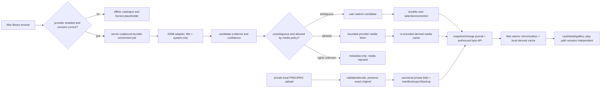

# Phase 4.7: Optional game artwork and metadata sync - Research

**Researched:** 2026-10-12
**Domain:** Optional game metadata provider, user-owned image custody, durable cross-client sync
**Confidence:** MEDIUM (API and terms reviewed from public official sources; image sublicense scope remains unresolved)

## User Constraints

### Locked Decisions

Copy from `.planning/phases/04.7-optional-game-artwork-and-metadata-sync/04.7-CONTEXT.md`:

- **D-01:** Support both optional external provider enrichment and private local images/text in this phase. Providers start disabled; absence of credentials/provider/media remains a complete browse/play experience.
- **D-02:** Provider requests disclose game title and system by default. ROM hash matching requires a separate explicit opt-in. Never disclose local filesystem paths, raw ROM/save bytes or play history; do not silently fall back to filenames or hashes. Explain when a displayed title derives from a filename and show the actual proposed query.
- **D-03:** After an informed provider enablement, bounded enrichment may run as the player browses. Whole-library/collection enrichment is a separate explicit action showing selected games, disclosed fields, estimated requests/download/storage and applicable provider limits. No prompt per ordinary lookup after this consent; changed disclosure or permissions require renewed consent. Disabling a provider stops new requests and pending work without deleting private assets.
- **D-04:** Select one production provider through current official API/terms research during planning; make provider provenance, version, attribution, permissible caching/expiry and redistribution visible. Prefer an option usable by a self-hoster with their own credentials, title/system queries and legitimate still-image offline use. Research may read public documentation, but no signup, account/credential configuration or collection lookup is authorized. Do not pretend unavailable rights are established; resolve concrete provider constraints in the research and final plans, with private local media always functional.
- **D-05:** Use a balanced still-media default: description and cover for a browsed game, with one representative screenshot on game details; additional gallery images download on opening the gallery or an explicit preparation action. No videos/manuals or automatic full-library scan.
- **D-06:** Provide understandable minimal/balanced and selected-game offline preparation behavior; avoid a settings wall. Offline preparation is bounded by a visible estimate and provider rights. Quotas, request coalescing, backoff, cancellation, restart recovery and partial/error states are real production behavior, not UI-only promises.
- **D-07:** Derived provider media has an explicit independent byte budget and reclaim action. Eviction affects only reconstructable, unpinned, legally refetchable media. Selected offline media consumes that same visible budget and respects expiry; capacity refusal is understandable. ROM cache, save reserve, canonical assets and private uploaded originals are excluded from media eviction. Research/planning selects concrete default limits and exposes useful controls.
- **D-08:** Keep private user media as canonical private assets with exact originals, provenance, documented export and backup custody. Thumbnails/display conversions are derived and bounded; deleting a derived cache cannot destroy a private original. Accept a deliberately narrow static-image input set and plain text; bounded decoding/processing must treat uploaded/provider bytes as untrusted. Research fixes exact formats, dimensions, byte/time caps and storage references.
- **D-09:** Enrich the existing native library card/grid and introduce a bounded per-game detail destination. Cover art occupies a stable area with its aspect ratio preserved; titles, readiness and direct Play/Continue remain available without opening details. No new sidebar category just for artwork and no storefront purchase/login friction.
- **D-10:** Game details prioritize cover/title and Play/Continue, then description and still-image gallery. Existing saves/readiness remain reachable through their established production routes. Catalogue screenshots are visibly game imagery, never represented as the player's progress, save compatibility or portability evidence.
- **D-11:** Missing, loading, offline-with-cache, stale/expired, ambiguous-match, partial, rejected and provider-error states have honest placeholders and concise contextual remedies. Enrichment errors must not escalate into a game readiness blocker. Never synthesize title-specific cover art or let loading replace meaningful game identity.
- **D-12:** Reuse semantic design tokens, focus/navigation bridges, accessibility identifiers, bounded destination return behavior and reduced-motion support. Gallery traversal and exit work with keyboard, the simulated controller seam and accessibility APIs. Preserve the selected game and focus on return. Test long titles, mixed art ratios, empty galleries and unavailable assets. Physical controller/Apple HID evidence stays parked.
- **D-13:** Store provider evidence separately from the player's field/media selections. User-corrected title/description, selected match, cover and screenshot choices survive later provider refreshes. Reset-to-provider is explicit per corrected field/selection, with source and version visible; a refresh never silently replaces user choices.
- **D-14:** Low-confidence or ambiguous results remain suggestions until chosen; show match evidence and confidence without claiming exact ROM identity from title similarity. Enrichment does not alter canonical ROM bytes, manifests, save-line identity or established cartridge qualification. Display-title corrections remain presentation metadata.
- **D-15:** Sync selected metadata/media references and corrections through the durable server snapshot/cursor and idempotent mutation/outbox paths, including offline queued edits and reconnect/reset. Separate synced selection from device-local cached availability. Concurrent incompatible user selections retain both alternatives and require a visible resolution rather than an unannounced winner; don't apply save-DAG machinery to metadata by default.
- **D-16:** Production-composition automated evidence closes machine-observable acceptance criteria. Use isolated synthetic authored media and existing fixture/CI lanes, exact nonzero discovery/execution and no skips. Cover absent/offline/error media, hostile images, stale consent, correction refresh/concurrency, journal reset, byte custody, quotas/eviction and keyboard/controller/AX gallery return. No mandatory owner UAT or repeated unchanged GB/GBC feasibility/gameplay runs.

### the agent's Discretion

Copy from CONTEXT.md:

- Owner delegated recommendations for the four areas and continuation into research and planning. Select a provider only from current public primary-source evidence; define concrete caps, additive protocol/schema representations, jobs, media pipeline and test selectors. Record how each chosen limit/term is enforced.
- Reuse established native visual foundations; create and check a Phase 4.7 UI-SPEC before planning. Design-contract generation is authorized as part of the requested planning outcome; no implementation, external account setup, publication or live collection lookup is authorized.
- Protocol additions requiring durable public contracts remain explicitly rated and checkpointed before implementation where required. A checkpoint should name the exact representation/decision and existing decision authority, not repeat a generic approval.

### Deferred Ideas (OUT OF SCOPE)

Copy from CONTEXT.md:

- Video previews, proprietary/manual retrieval, in-game pause overlay, player-progress screenshots, save-state transfer, public media sharing and Phoenix console redesign remain follow-on scope.
- Automatic unlimited bulk scraping and counterfeit synthesized game artwork are rejected, not future features.
- Todo matches for physical DualSense qualification and older save-E2E/suite nondeterminism remain in their existing tasks; lexical matches do not expand Phase 4.7. Reuse controller navigation, but do not reopen the prior generic controller-navigation todo as artwork work.

## Phase Requirements

| ID | Description | Research Support |
|---|---|---|
| META-01 | A user can install or select additional metadata, DAT, and artwork providers whose source, version, confidence, attribution, caching, and redistribution terms remain visible. | This phase implements one selected optional provider adapter and user-local media path; persist provenance, evidence/confidence, attribution and use/cache policy with each asset. DAT import remains the existing recognition system and must not be conflated with title enrichment. |

## Summary

Select **IGDB as the single optional production enrichment provider** for this phase. Its official API supports game-name search, platform/release-date fields, summary, cover and screenshot references; its FAQ explicitly allows local caching and serving retrieved data to end users, with user-facing attribution guidance and retention after partnership termination. The API is disabled until a self-hoster supplies their own Twitch application credentials and the user consents to the exact title + system query. No credentials are needed for the deterministic adapter, tests, or private-media path. [CITED: https://api-docs.igdb.com/]

Make the provider an adapter behind server application services, not part of the ROM recognizer or native launch path. Store external candidate evidence separately from selected display fields and local media. Persist user corrections and selection revisions as the synced truth; model local downloaded availability and provider-derived cache eviction separately. Use the existing PostgreSQL job, blob-store, API, catalogue snapshot/journal, and Mac mirror/outbox seams. Existing protocol payload is frozen, so any new snapshot/journal entity or catalogue field is an additive durable contract that requires the named compatibility checkpoint in CONTEXT.md before implementation.

**Primary recommendation:** One IGDB adapter with server-side secrets and request brokering, title/platform matching with explicit user choice when ambiguous, one screenshot/cover at bounded image variants, plus private local PNG/JPEG originals through canonical blob custody. Never rely on IGDB-derived images for public redistribution. Fail closed for provider images when applicable rights or license revision is unknown; keep private local media fully available.

## Architectural Responsibility Map

| Capability | Primary Tier | Secondary Tier | Rationale |
|---|---|---|---|
| Provider consent, title/platform request and matching | API / Backend | Browser / Client | Server owns credentials, scoped rate limits, durable job state and sanitized request logs; Mac previews the exact fields/query and initiates consented work. |
| Candidate evidence, corrections and synchronized selections | Database / Storage | API / Backend | PostgreSQL is the durable source of provenance, alternatives, revisions and journal cursor state; controllers only expose application commands. |
| Provider and private media bytes | Database / Storage | CDN / Static — | Canonical private uploads use `Playstead.Blobs.Store`; provider cache uses an independently reclaimable derived-media store. Never place ROM paths or provider tokens in media URLs. |
| Offline media cache and availability | Browser / Client | Database / Storage | Mac tracks device-local cached bytes independently of synced selection and continues to use the existing verified game cache for play. |
| Cards, details and screenshot gallery | Browser / Client | API / Backend | SwiftUI owns native presentation, controller/keyboard/AX navigation; server supplies versioned metadata and authorized media reads. |

## Standard Stack

### Core

| Library | Version | Purpose | Why Standard |
|---|---|---|---|
| Existing Phoenix + Ecto/PostgreSQL application | Resolver-selected locked versions | Provider adapter, scoped metadata/media records, APIs, transactions and jobs | Already committed project platform; no extra service or provider SDK is needed. [CITED: `.planning/STACK.md` is embedded in AGENTS.md] |
| Existing Req HTTP client | Already in lockfile | IGDB HTTP/API and image downloads | Server AGENTS.md explicitly directs reuse of `:req`; don't add an HTTP client. [VERIFIED: `playstead-server/AGENTS.md` “Use the already included and available :req (Req) library”; exact package version intentionally resolver-selected] |
| Existing Oban | Resolver-selected lock | Restart-safe enrichment, download, decode/derivative and eviction work | Stack decision recommends durable Postgres jobs for user-visible import/background work. Use idempotent bounded workers and persist state, not LiveView tasks. [CITED: `AGENTS.md` embedded Technology Stack, Oban row] |
| Existing SwiftUI/SQLite client and `URLSession` | Current pinned Xcode project | Native cards/detail/gallery, local mirror/outbox and derived media cache | Reuses shipped native composition, existing test wrapper, and no third-party image package. |

### Supporting

| Component | Purpose | When to Use |
|---|---|---|
| Existing `Playstead.Blobs.Store` local disk adapter | Immutable canonical private-upload bytes | Use for exact original local PNG/JPEG media and export/backup custody. Do not store provider cache here as canonical user content. |
| Existing `Playstead.Sync.Snapshot`, `ChangeJournal`, `EntityKind` and Mac `JournalApplier`/`Outbox` | Durable sync and convergence | Extend only via additive schema/payload/capability and protocol checkpoint; include reset/snapshot and concurrent mutation conflict behavior. |
| Apple ImageIO/CoreGraphics | Decode and create display-sized derivatives | Decode untrusted PNG/JPEG off the main actor with dimension/frame/byte checks; preserve original separately. [CITED: https://developer.apple.com/documentation/imageio] |

### Alternatives Considered

| Instead of | Could Use | Tradeoff |
|---|---|---|
| IGDB | RAWG | RAWG has a good game search/screenshots API, but its official API page offers Free as noncommercial with backlinks; API Terms describe personal and low-volume commercial plans, while site Terms restrict API/content use to private noncommercial purposes. This conflict is material for a self-hosted ecosystem and images. Exclude until RAWG clarifies an authoritative governing commercial/data/media grant. [CITED: https://rawg.io/apidocs, https://rawg.io/tos_api, https://rawg.io/terms] |
| IGDB | MobyGames API | Official API page currently describes access as non-commercial; lacks adequate verified cache/redistribution terms for this project's image-serving model. [CITED: https://api.mobygames.com/v1/] |
| IGDB provider imagery | Private local images/text only | Always available and user's rights/custody clearer; does not fulfill optional title-matched provider cover/gallery capability selected by owner. Keep as first-class companion. |

**Installation:** None. No external provider client/package is recommended.

## Provider Terms and Rights Decision

**Official source reviewed 2026-10-12:** IGDB API documentation/FAQ (`https://api-docs.igdb.com/`). The docs state that API access is free for noncommercial use under Twitch Developer Services Agreement; commercial projects require a commercial partnership inquiry. IGDB says local caching is allowed and preferred, user-facing fair attribution should be visible/static for partnered integrations, and retrieved data may be retained after partnership termination. API authentication uses application credentials and access tokens (documented 60-day expiry); its proxy guidance exists to keep credentials server-side and supports request caching. The docs describe game search, platform/release-date fields, summary, cover, screenshot fields and fixed image sizes up to 1920x1080. [CITED: https://api-docs.igdb.com/]

**Production use decision:** support IGDB for this open-source, self-hosted, noncommercial operation when the operator has accepted applicable Twitch developer terms and provides their own application credentials. Do not make a Playstead-hosted shared credential or hosted commercial service part of this phase. A commercial Playstead distribution/hosting operator must not enable this adapter until IGDB partnership terms are obtained. Attribution appears in detail and provider settings, including static `IGDB` link. Retain cached provider metadata/media across cache refreshes only while the recorded policy permits; provide remove-provider-cache action and obey any updated takedown/term signals. [CITED: https://api-docs.igdb.com/]

**Rights limitation / fail-closed rule:** IGDB documentation grants local cache/serve behavior for its API outputs, but the reviewed FAQ does not state that IGDB owns all cover/screenshot copyrights, warrants sublicensing rights, or grants public redistribution. API-data permission is not a blanket license for the underlying publisher/developer artwork. Therefore store a per-asset `usage_policy` and terms revision; serve only to the consenting owner's paired devices/private instance, do not expose unauthenticated/public media URLs or public exports, and don't mark redistribution permission true. For any image whose rights or current terms are unknown/revoked, retain candidate metadata without downloading/serving the image and show unavailable/rejected state. **Unresolved external fact:** whether IGDB/Twitch's applicable agreement affirmatively authorizes a self-host operator to locally cache and privately serve third-party image bytes to that operator's own authenticated clients, and whether this is distinct from broader redistribution. Planning should include a narrow `checkpoint:human-verify` against that exact clause/decision authority (owner/legal counsel or written IGDB response) before enabling provider-image fetch in production; keep provider descriptions and private local images independent. Do not defer the complete provider adapter or local media work on this single rights gate.

### Provider Selection Comparison

| Provider | Search and media fit | Caching / attribution | Commercial and rights result | Decision |
|---|---|---|---|---|
| IGDB | Game search plus platform/release-date, summaries, covers, screenshots and bounded image variants | Explicit local cache encouragement; fair visible attribution for partnership; retrieved API data retained after partnership ends | Noncommercial API; commercial partnership required. Underlying artwork grant/sublicense is not clearly stated by reviewed FAQ | Select adapter. Metadata path can be implemented; image retrieval guarded by fail-closed usage policy until exact private-serving grant is confirmed. |
| RAWG | Search and many screenshots/metadata | Free plan requires backlinks; ToS says API free for personal noncommercial use | API docs/ToS describe commercial tiers but site ToS says API/content noncommercial only; image rights disclaimer does not grant third-party rights | Reject due conflicting governing terms. |
| MobyGames | API exists | Cache and attribution rules not established by official public API landing page reviewed | Page says non-commercial access | Reject for current phase. |

## Architecture Patterns

### Data flow



### Existing code anchors and recommended boundaries

| Capability | Existing analog | Planning target |
|---|---|---|
| Provider boundary and version | `playstead-server/lib/playstead/recognition/provider.ex` | Add separate `Playstead.Metadata.Provider` behavior and IGDB adapter; recognition `confidence` answers ROM/reference evidence and must not be reused as match confidence. |
| Frozen API payload | `playstead-server/lib/playstead/catalogue/payload.ex` | Keep existing frozen catalogue payload intact or add a separate `enrichment` entity kind/branch with a versioned payload and compatibility checkpoint. |
| Registered journal kind | `playstead-server/lib/playstead/sync/entity_kind.ex` | Current quote: `@kinds ~w(device pairing catalogue job transfer save curation)a` [VERIFIED: `playstead-server/lib/playstead/sync/entity_kind.ex:25-29`]. Add an additive `metadata` kind only after required protocol checkpoint. |
| Snapshot and as-of cursor | `playstead-server/lib/playstead/sync/snapshot.ex` | Add metadata/media selections inside same consistent snapshot transaction and cursor; page/reset behavior must reconstruct same current state. |
| Immutable private bytes | `playstead-server/lib/playstead/blobs/store.ex` | Reuse for private originals; the adapter contract says committed bytes are not deleted/mutated. Provider-derived assets belong in separate reclaimable cache object namespace/table. |
| Local catalogue transaction | `playstead-mac/Playstead/Persistence/CatalogueStore.swift` | New `MetadataStore`/`MediaSelectionStore` page upsert and snapshot replacement inside the same `LocalStore.transaction` as journal cursor. Keep cache rows separate from synced selection. |
| Offline cache accounting | `playstead-mac/Playstead/Cache/CacheObjectStore.swift`, `QuotaManager.swift` | Add independent enrichment media ledger/budget and eviction class; never count canonical originals/saves or evict ROM cache as artwork. |
| Existing UI | `Library/GameRowView.swift`, `Library/LibraryShellView.swift`, `Library/SystemMonogramView.swift`, `Persistence/CatalogueStore.swift`, `Library/LibraryViewModel.swift` | Extend current card/detail composition; keep Play/Continue as direct accessible actions and placeholder based on `SystemMonogramView`. Read current `03-UI-SPEC.md` then create phase 4.7 UI-SPEC before planning per D-Discretion. |

### Durable jobs, quotas and idempotency

- One durable `metadata_enrichment` record/job per `(user_id, asset_set_id, provider, query_fingerprint, requested_media_policy_revision)`. Unique active-job constraint plus `Oban.unique` window coalesces repeated browse triggers. Query fingerprint includes normalized consented title and system but logs/store must not retain raw paths or hashes.
- Browse creates only one on-demand job for title/description/cover metadata and representative screenshot reference. Gallery open requests the selected bounded screenshot set. Explicit preparation requires selected games and displays counts, estimate and quota first. Disable-provider cancels queued jobs and causes in-flight workers to check consent revision before every outbound request and before persisting results.
- Use global and per-user provider token bucket (initial recommendation: 4 IGDB requests/sec instance-wide, max 2 concurrent provider jobs per user, 20 in-flight image decodes/instance); honor 429 `Retry-After`, exponential backoff with jitter (1s→1h, max 8 attempts), retry only transient/network/429/5xx. Persist attempt/state/next-attempt/error class and show partial outcome; permanent 4xx/policy reject is terminal. These are Playstead safety caps, not claimed IGDB quotas.
- Cap one enrichment response to 10 candidate rows; fetch only selected candidate's cover plus one representative screenshot, and at most 8 selected gallery screenshots. API plan estimate reports exact request upper bound. Max one image response 12 MiB compressed, width/height ≤ 8192, decoded pixels ≤ 40 million, single frame only. Decode in bounded worker; sniff content, require PNG/JPEG, reject SVG/animated/unknown MIME, dimensions or mismatch, re-encode derived display variants, record SHA-256 and source transform. Never follow arbitrary provider-returned URL hosts; construct only approved IGDB image URLs from image ID and fixed size allowlist.
- Provider cache recommendation: 1 GiB/user, evict least-recently-used unpinned and refetchable assets; 12 MiB per screenshot, 8 MiB per cover, 32 MiB max prepared gallery per game, concurrency 2 transfers/user and 2 serverwide decode workers. Store selected-offline pins in same budget. Metadata can persist independently, but media expiry/revocation removes derived provider bytes without changing title corrections, game blobs or private user uploads. Default provider image cache age 30 days then revalidate; IGDB docs specifically note removed/replaced images remain available for 30 days, so do not treat that grace period as rights or freshness guarantee. [CITED: https://api-docs.igdb.com/]
- Private local media limits: accept only static PNG/JPEG, plain text ≤ 64 KiB, image original ≤ 20 MiB, max dimensions 8192x8192 and 40 MP decode, one frame, total 10 private media items/game. ImageIO decode with bounded time/worker; store exact original bytes as immutable canonical blob, and record derivative/thumbnail separately. User assets are not in the provider-cache eviction pool and remain eligible for documented export and backup.
- Corrections: provider refresh writes evidence rows/candidate revisions only. User selections are an explicit mutation against base revision with idempotency key. If competing incompatible user edits share a base version, preserve both proposed values and publish visible unresolved state; resolution is a new user mutation. Reset-to-provider is per field/media selection and requires current provider evidence.

### API and sync contract direction

Preserve `/api/v1`, problem+json, scoped context, idempotent command receipts and journal/snapshot conventions. Proposed representations (final shapes require protocol checkpoint): provider status/config is per user, but secret remains server-only; candidate evidence includes provider/version, external candidate ID, title/system evidence, score bucket/method, timestamps and applicable policy revision; synced game-enrichment selection includes field values, source/evidence reference, attribution/usage policy, user override flag, revision and selected media IDs; media byte response is a separately authorized resource ID with content type, size and SHA-256. Never mirror provider credentials or local cached/availability state.

`metadata` journal entries carry a changed entity ID/revision and tombstone only; client fetches its current metadata selection, while a versioned `metadata` snapshot branch restores it at same cursor. Add capability/version negotiation and additive OpenAPI schemas/examples before native usage. Mac outbox mutation sends only selected metadata/corrections and references; cache availability remains local. A cursor reset must replace metadata selections atomically with catalogue/curation and then reconcile cache references without deleting unrelated canonical blobs.

### Private asset custody/export

Private upload: bounded multipart request → stream exact original into temporary storage while hashing → validation/decode in isolated bounded worker → commit immutable original through blob CAS → store media manifest/provenance → journal selection. Failed decode removes only its uncommitted temporary file. Store schema records `media_role`, original blob reference, original MIME/dimensions/hash/size, source=`user_upload`, transformation lineage and selected state. Derivative thumbnails are regenerable cache objects with explicit cleanup.

Extend existing export sidecar/layout/BagIt verification with a `media/` section for private originals plus source/attribution/correction metadata. Add exact original SHA-256/size in manifest and verify restore against original object. Provider cache bytes are excluded from canonical exact-byte export; export records their provider/source/usage status and can optionally omit them. Backups include canonical private originals through existing blob inventory; derived provider cache is independently re-creatable and not a required restore subject. Do not mutate or rewrite imported game bytes or save identities.

### Native UI integration

Use stable aspect-ratio cover slot and preserve title/system/readiness/direct Play/Continue on every absent/error state. Detail order: cover/title/actions, description and match/source evidence, one representative catalogue screenshot then gallery. Screenshot UI label must state “game screenshot” and never imply player progress/save evidence. Keyboard, `UITestControllerInputSource` navigation bridge, and accessibility identifiers enter/traverse/exit gallery; restore selected game and focus on return. Reduced-motion follows existing motion tokens. Avoid title-specific generated art.

## Don't Hand-Roll

| Problem | Don't Build | Use Instead | Why |
|---|---|---|---|
| Durable work, restart/retry/coalescing | In-memory Task/GenServer queue or view-triggered request | Existing Oban/PostgreSQL durable job pattern | Jobs must survive app navigation/server restart and expose partial/error state. |
| Content-addressed exact originals | Custom path-based media store or transform original in place | Existing `Playstead.Blobs.Store` immutable CAS for private uploads | Preserves byte custody, digest verification and export/backup seam. |
| Client convergence | Socket as semantic source of truth or cache state in journal | Existing snapshot cursor + change journal + local transactional mirror/outbox | Missed changes/reset converge; device-local availability stays local. |
| Hostile image handling | Trust MIME, decode on main actor or parse arbitrary remote URL | ImageIO + strict allowlist, byte/dimension/pixel/frame caps, controlled IGDB host | Compressed small images can expand into memory bombs or parser attacks. |
| Similarity as ROM identity | Treat matching title/platform as proof of ROM bytes/system/save lineage | Separate metadata match confidence/evidence from byte recognition and save-line identity | Similar title does not prove exact release or compatibility. |

**Key insight:** Provider data is a suggestion stream. The user's selected/corrected presentation state and private originals are the durable truth; provider evidence and downloaded provider images are replaceable, bounded and rights-gated.

## Common Pitfalls

### Provider policy turns into false media-license certainty
**What goes wrong:** API cache permission is treated as copyright permission to redistribute image bytes.
**Why:** Database/API terms and the underlying image copyright are separate rights.
**How to avoid:** Record terms revision, usage flags and attribution per asset; private authenticated delivery only, no public export/distribution flag; exact rights checkpoint before enabling provider image fetch.
**Warning signs:** “IGDB allows caching, so images are open” or unqualified public CDN URLs.

### Lookup quietly leaks collection identity
**What goes wrong:** Query uses filename/hash when title search misses, or logs raw request.
**How:** Build request from displayed/proposed title and system only; show both before enabling; query hash is opt-in separate; redact title from generic logs and telemetry; never send path/ROM/save/history.

### Provider match overwrites human correction
**What goes wrong:** Refresh updates display title/cover and erases user choice.
**How:** Separate evidence table from user selection/revision; only explicit accept/reset updates selection; conflict keeps both alternatives.

### Media cache competes with game/save custody
**What goes wrong:** Existing ROM quota eviction removes canonical media or spends save reserve.
**How:** Separate provider cache accounting, pin/refetchability and reclaim path; private originals live in canonical store; no artwork eviction touches ROM/save/private originals.

### Gallery image decode blocks browse/play or crashes process
**How:** Fixed-size variants, image validation and off-main bounded decoding, derivative cache and nonblocking placeholders; never make readiness depend on enrichment.

### Snapshot/journal can’t restore media selections
**How:** Define metadata capability, additive versioned payload/entity, transactional snapshot branch, atomic page and reset tests before client consumes data. Keep byte cache/availability out of synced state.

## Code Examples

IGDB documents name search and selected field projection. Keep platform as a required result check using IGDB platform/release-date relations; search result alone is only candidate evidence. Do not send this request until explicit consent exists. [CITED: https://api-docs.igdb.com/]

```text
POST https://api.igdb.com/v4/games/
Authorization: Bearer <server-side application token>
Client-ID: <server-side application id>

search "<consented displayed title>";
fields id,name,summary,platforms,release_dates.platform,cover.image_id,screenshots.image_id;
limit 10;
```

For a selected/confirmed match, construct image URL from validated image ID and a fixed IGDB size, e.g. `cover_big` or `screenshot_med`; cap screenshot to 1280x720 (`screenshot_huge`) only for user-selected gallery fetch. Avoid unrestricted `fields *` or provider-supplied arbitrary URLs. [CITED: https://api-docs.igdb.com/]

## Validation Architecture

### Test Framework

| Property | Value |
|---|---|
| Server | ExUnit + Ecto SQL Sandbox; `mix precommit` (format warnings-as-errors + full `mix test`) |
| Mac | XCTest in `Playstead` Xcode scheme; wrapper `cd playstead-mac && scripts/ci/run-mac-verification.sh --layers unit --only-testing PlaysteadTests/<Suite>` |
| Packaged native UI | `PLAYSTEAD_HUMAN_APPROVED_LOCAL_APP_LAUNCH=1 scripts/ci/run-mac-verification.sh --layers ui --only-testing PlaysteadUITests/<Suite>` (scope env inline to one command only) |
| Real server/native composition | `scripts/ci/run-mac-verification.sh --layers live-server --only-testing PlaysteadUITests/<Suite>` using synthetic media/provider stub; no collection data or external request |
| CI | Extend existing Mac unit/UI/live-server lanes and existing server CI `mix precommit`; exact identities discovered once, nonzero, zero skips. No new provider account/service lane. |

### Phase Requirements → Test Map

| Criterion | Behavior | Test Type / planned identity | Command / lane | Existing? |
|---|---|---|---|---|
| 1 | Stable cards/details/gallery, placeholder, direct actions and keyboard/controller/AX return | Unit + packaged UI `MetadataGalleryNavigationTests/testGalleryReturnsFocusToSelectedGameAcrossKeyboardControllerAndAX` | Mac unit and `--layers ui` | ❌ Wave 0 |
| 2 | Disabled default, previewed title/system disclosure, hash opt-in, provider version/attribution/cache terms | ExUnit `MetadataConsentTest`, `MetadataProviderContractTest`; UI `MetadataConsentTests/testProposedQueryAndDisclosureAreVisibleBeforeRequest` | Server `mix test`; Mac `--layers ui` | ❌ Wave 0 |
| 3 | Correction survives refresh, concurrent edits, snapshot/change/reset and byte custody | ExUnit `MetadataConvergenceTest`; Mac `MetadataJournalTests/testSnapshotChangeReplayAndExpiredCursorResetPreserveSelection`; live `MetadataPrivateMediaJourneyTests/testPrivateOriginalUploadSyncsToMacAndExportsExactBytes` | Server `mix test`; Mac `--layers live-server` | ❌ Wave 0 |
| 4 | coalescing, quotas/backoff/cancel/restart, partial/offline/error, expiry and isolated eviction | ExUnit `MetadataWorkerTest`; Mac `MetadataCachePolicyTests/testBoundedReclaimDoesNotTouchROMSaveOrPrivateOriginals` | Server `mix test`; Mac unit | ❌ Wave 0 |
| 5 | hostile assets, no provider network, correction/cache/convergence production composition | ExUnit `PrivateMediaValidationTest`; Mac `MetadataPipelineTests/testMockProviderAndHostileImagesStayOfflineSafe` + named journey above | Existing Mac live-server lane plus server `mix precommit` | ❌ Wave 0 |

**Required evidence discipline:** register exact test identities in the current required-test allowlist; wrapper must fail on absent, duplicate, skipped or zero execution. A fake IGDB transport and authored synthetic PNG/JPEG are the only fixtures. Assert outbound request fields and host with a local transport spy, zero calls when disabled/stale consent, no filenames/paths/hashes/body/play history, exact original SHA-256 on export, derivative eviction only, and all snapshot/reset data applied atomically. Avoid existing AerevenAdvance ROM unless a criterion specifically requires play/save integration; this phase does not.

### Wave 0 Gaps

- [ ] Server schema/provider behavior, fake transport, bounded worker, private image upload validation, metadata API, journal and snapshot tests.
- [ ] Mac persistence schema, local mirror/outbox, media downloader/cache-ledger, image decode validator and library/detail/gallery composition tests.
- [ ] Required test identity allowlist entries and no-skip/nonzero result registration in existing wrappers/CI.
- [ ] UI-SPEC for Phase 4.7, reviewed with Impeccable/Emil guidance as directed.

## Security Domain

### Applicable ASVS Categories

| ASVS Category | Applies | Standard Control |
|---|---|---|
| V2 Authentication | Yes | Existing authenticated API/device pairing; provider secret is operator-side only and never sent to Mac. |
| V3 Session Management | Yes | Existing device token/session controls; revoke/reset media download authorization with device revocation. |
| V4 Access Control | Yes | Every media metadata/blob query is scoped by current user and authorized paired device; private originals never public. |
| V5 Input Validation | Yes | Schema/title length bounds; PNG/JPEG decode checks, MIME sniff, content-length streaming cap and path/URL allowlist. |
| V6 Cryptography | Yes | TLS, existing SHA-256 CAS integrity, secret store; no custom crypto. |

### Known Threat Patterns

| Pattern | STRIDE | Standard Mitigation |
|---|---|---|
| Malicious image/decompression bomb | Tampering / DoS | Bounded decode worker, compressed-byte and decoded-pixel limits, static-only allowlist, timeout, no main-actor decode. |
| SSRF via provider image URL | Spoofing / Info disclosure | Construct image URL from approved host and validated identifier; reject redirects/host changes/private IPs. |
| Cross-user media ID guess | Info disclosure / Elevation | Scope records and stream authorization by owner/device; non-public object identifiers alone are not auth. |
| Credential or query leaks to logs | Info disclosure | Server-side credentials, redacted logs/telemetry, consent preview, never include local filename/path/hash/save bytes. |
| Quota abuse/retry storm | DoS | per-user/instance limits, coalescing, bounded retry with jitter, cancellation and durable partial status. |

## Assumptions Log

| # | Claim | Section | Risk if Wrong |
|---|---|---|---|
| A1 | IGDB/Twitch permits a self-host operator to fetch/cache/privately serve underlying publisher/developer image files to paired clients under the operator's own credentials. | Provider Terms | Incorrect assumption creates image copyright or agreement breach. Explicit rights checkpoint and fail-closed image policy; do not tag as verified. |
| A2 | Recommended initial product limits (1 GiB/user provider cache; PNG/JPEG and stated per-file/pixel bounds) are acceptable defaults for expected self-host scale. | Jobs/cache and private upload | May require tuning; bounded values are design defaults, not external provider quotas. |
| A3 | One new additive `metadata` entity/capability plus separate asset byte routes is the least disruptive protocol shape. | API and sync | Protocol checkpoint may choose another additive representation; don't change frozen payload implicitly. |

## Open Questions

1. **Exact IGDB private-media rights.** The API FAQ permits local caching and serving data, but does not clearly grant a sublicense for all third-party image bytes. Resolve exact contract clause and user-authorized delivery scope before activating provider-image fetch. Fail closed for image bytes meanwhile; finish metadata adapter, private image uploads, schema/UI and tests independently.
2. **Commercial evolution.** Current IGDB docs require commercial partnership for commercial project use, and RAWG official pages have inconsistent commercial grants. Keep commercial use disabled until a separate operator obtains written provider terms and a reviewed launch decision.
3. **Protocol compatibility checkpoint.** Decide whether metadata is a new journal kind/capability or a backward-compatible catalogue extension. The current catalogue payload is expressly frozen; do not quietly add keys.

## Sources

### Primary (official provider/platform sources)

- [IGDB API docs](https://api-docs.igdb.com/) — official search, fields, platform/release-date, cover/screenshots, image dimensions, caching, attribution, credential and commercial FAQ; accessed 2026-10-12.
- [RAWG API docs](https://rawg.io/apidocs), [RAWG API Terms](https://rawg.io/tos_api), [RAWG site Terms](https://rawg.io/terms) — official comparison; API plan and site-terms commercial-use inconsistency; accessed 2026-10-12.
- [MobyGames API](https://api.mobygames.com/v1/) — official landing says non-commercial access; accessed 2026-10-12.
- [Apple ImageIO](https://developer.apple.com/documentation/imageio) — native image decode API reference; accessed 2026-10-12.

### In-repository sources (opened this session)

- `AGENTS.md` — locked stack, custody, data/privacy/security posture, validation automation, exact wrapper conventions.
- `.planning/ROADMAP.md` Phase 4.7 — goal, scope and five success criteria.
- `.planning/REQUIREMENTS.md` META-01 — provider provenance and terms requirement.
- `.planning/phases/04.7-optional-game-artwork-and-metadata-sync/04.7-CONTEXT.md` — all D-01…D-16 and scope fence.
- `.planning/seeds/SEED-037-on-demand-game-artwork-and-metadata.md`, `SEED-008-in-game-instructions-and-manual-metadata.md`, `SEED-006-save-progress-screenshots-and-game-hub.md` — artwork policy, bounded delivery, and catalog/progress screenshot distinction.
- `playstead-server/AGENTS.md` — Req reuse, Phoenix/Ecto/auth/test rules.
- `playstead-server/lib/playstead/catalogue/payload.ex:17-49` — frozen catalogue key set and payload; `playstead-server/lib/playstead/sync/entity_kind.ex:25-37` — registered entity kinds verbatim; `playstead-server/lib/playstead/sync/snapshot.ex:96-120` and later branches — one transaction/as-of cursor snapshot pattern; `playstead-server/lib/playstead/blobs/store.ex` — immutable blob adapter; `playstead-server/lib/playstead/recognition/provider.ex` — provider/version/confidence analog.
- `playstead-mac/Playstead/Persistence/CatalogueStore.swift:1-115` — transactional local mirror analog; `playstead-mac/Playstead/Cache/CacheObjectStore.swift`, `QuotaManager.swift:1-65` — cache ledger/quota/floor analog; `Library/GameRowView.swift`, `Library/LibraryShellView.swift`, `Library/SystemMonogramView.swift`, `Sync/Outbox.swift`, `Sync/JournalApplier.swift`, `Persistence/Migrations.swift` — native integration seams.
- `.planning/phases/03-mac-offline-play-vertical-slice/03-CONTEXT.md`, `03-UI-SPEC.md`; `.planning/phases/03.5-mac-verification-automation/03.5-CONTEXT.md`; `.planning/phases/04-persistent-save-continuity/04-CONTEXT.md`; `.planning/VERIFICATION-AUTOMATION.md`; `playstead-mac/docs/TEST-FIXTURES.md` — existing interface and automation precedents.

## Project Constraints (from AGENTS.md)

- Private user-supplied content only. Do not distribute or facilitate ROM/BIOS acquisition.
- Preserve exact original bytes and provide documented verified export; distinguish canonical originals from derived caches.
- Never silently discard corrections/conflicts or mutate imported source data.
- Optional enrichment must not block offline play.
- Treat uploads, archives, metadata, filenames and parsers as untrusted; validation, quotas, bounded workers and isolation are required.
- Keep client semantics in `/api/v1` and application services; LiveView is not native client protocol. Reconnect/reset converges from durable snapshot/journal state.
- Follow project skill `spike-findings-playstead` only for GB/GBC/mGBA/battery/RTC/save-restore work; this artwork phase must not reopen those spikes.
- Start through GSD workflow; preserve all unrelated dirty workspace edits. Use existing fixtures/wrappers, exact nonzero/no-skip checks, and do not ask for physical HID/UAT.
- Server AGENTS.md additionally requires existing Req HTTP client, scoped authenticated contexts, `mix precommit`, Phoenix 1.8 conventions, and ExUnit sandbox practices.

## Environment Availability

No external runtime prerequisite is needed to plan or test this phase: provider is optional, credentials are a self-hoster runtime setting, and all deterministic provider tests use a mock transport and local authored images. `playstead-server` requires its existing Elixir/PostgreSQL development/test environment for `mix precommit`; Mac tests use the existing Xcode wrapper. Do not configure credentials or call provider endpoints with user collection data in phase planning.

## Metadata

**Confidence breakdown:**
- Provider API surfaces/cache statements: MEDIUM — official docs read, but terms applicability for underlying third-party media unresolved.
- Architecture: HIGH — existing repository seams read directly and owner context is explicit.
- Caps/policies: MEDIUM — proposed conservative product defaults, not provider quota claims.
- Verification mapping: HIGH — based on existing wrapper/lanes and project automation policy; new test identities remain to be authored/registered.

**Research date:** 2026-10-12
**Valid until:** 2026-11-11 (check provider terms again before enabling integration)

## Planning refinement

The orchestrator caps serverwide decode workers at 2 to bound decoded-image memory; 20 was a proposed research default, not a measured requirement. The linked Twitch Developer Services Agreement currently returns a boilerplate page without readable terms in the public fetch. That missing clause is an evidence limitation, not a confirmed denial. Provider activation remains conditional on applicable operator terms; software, private media and deterministic provider seams proceed independently. Primary refresh: https://legal.twitch.com/en/legal/developer-agreement/ accessed 2026-10-12. No legal counsel action, provider message, account setup or data lookup was requested.
